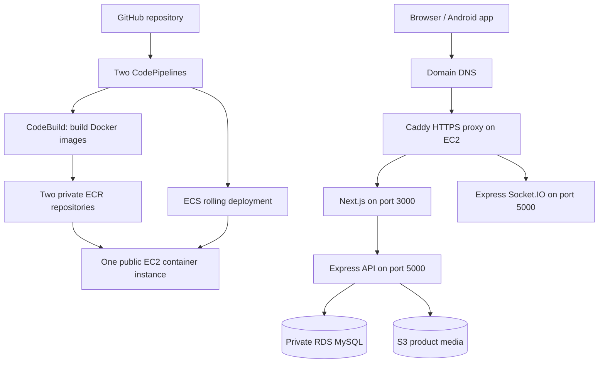

# Low-Cost AWS Deployment Guide

Deploy the existing Next.js frontend and Express backend using CodePipeline,
CodeBuild, ECR and ECS on one EC2 instance, without a NAT Gateway or load balancer.

This is a deployment runbook, not an automated infrastructure template. Creating
this document does not provision AWS resources or change application configuration.
Application changes identified below must be completed and tested before deployment.

## 1. Architecture and Tradeoffs



| Keep | Avoid initially |
| --- | --- |
| Next.js standalone frontend and Express backend | Static frontend rewrite |
| CodePipeline, CodeBuild and private ECR | Building application images on the small production host |
| Standard ECS on EC2 | Fargate and ECS Managed Instances management fees |
| Private RDS and S3 media | NAT Gateway and Application Load Balancer |
| CloudWatch logs, backups and secrets | Multiple always-running application instances |

Standard ECS on EC2 has no separate orchestration fee. EC2 and supporting services
are still billable. This design has one application server: host failure causes
downtime, and fixed-port deployments stop the previous task before starting its
replacement. It is not a highly available or zero-downtime design. You manage host
patching, proxy maintenance and recovery. Do not use it if those tradeoffs are unacceptable.

## 2. Recover Data and Set a Budget First

1. Check all previously used AWS regions for surviving resources and charges.
2. Look for RDS snapshots, AWS Backup recovery points, S3 objects and ECR images.
3. Restore database data from a verified backup when available. A new database
   cannot recover deleted users, orders or balances without a backup.
4. Recover domain access and integration configuration for email, OTP, Firebase
   and any payment provider. Never paste secret values into chat or commit them.
5. Create monthly AWS Budget alerts, for example at USD 50, 75 and 100. Choose
   thresholds matching your budget; alerts do not stop resources or spending.
6. Check for remaining NAT gateways, unattached disks, public IPs and snapshots.
   Confirm ownership and recovery requirements before removing anything.

Your September screenshot showed USD 94.35 for NAT Gateway hours and processing,
and USD 40.23 for gp3 disks. Avoiding NAT addresses that historical cost, but does
not guarantee the same reduction in a future month or eliminate other charges.

## 3. Choose Names and a Region

Use one region for application resources, ECR, builds and pipelines. The examples
below assume Mumbai; replace it if your data or users require another region.

| Setting | Example |
| --- | --- |
| Region | `ap-south-1` |
| ECS cluster | `skaarvi-low-cost` |
| Frontend ECR repository | `ecom-frontend` |
| Backend ECR repository | `ecom-backend` |
| Frontend service | `skaarvi-frontend` |
| Backend service | `skaarvi-backend` |
| Frontend container name | `frontend-container` |
| Backend container name | `backend-container` |
| Site hostname | `skaarvi.shop` |

## 4. Create the VPC and Security Groups

1. In VPC, create a VPC with DNS resolution and DNS hostnames enabled.
2. Create one public subnet for the application and two private database subnets
   in different Availability Zones. Choose non-overlapping CIDRs.
3. Attach an Internet Gateway to the VPC.
4. Associate the public subnet with a route table containing `0.0.0.0/0` to the
   Internet Gateway. The EC2 host also needs a public IPv4 address.
5. Keep database subnet route tables without an internet default route.
6. Do not create a NAT Gateway. Check VPC wizard defaults before confirming.
7. Create an application security group allowing inbound TCP 80 and 443 from
   internet clients. Do not open 3000, 5000, 3306 or SSH to the internet.
8. Create a database security group allowing inbound TCP 3306 only from the
   application security group.
9. Allow application outbound access needed for AWS APIs, database connections,
   certificate issuance and third-party services. Use Systems Manager Session
   Manager for administration, with no public SSH port.

An S3 Gateway VPC Endpoint is optional and has no additional endpoint charge.
Do not add paid interface endpoints by default: public HTTPS AWS endpoints are
reachable from this public application host without NAT.

## 5. Restore or Create RDS

1. Create a DB subnet group using the two private database subnets.
2. Restore a compatible MySQL snapshot, or create RDS MySQL if no backup exists.
3. Select Single-AZ and a small instance supported by the selected engine version.
   Price a burstable small instance first; confirm memory and connection needs.
4. Disable public accessibility and attach the database security group.
5. For a new database, start with appropriate storage, such as 20 GB, if sufficient.
   Set an intentional storage-autoscaling limit if enabling autoscaling.
6. Enable automated backups, for example seven days, and deletion protection.
7. Record the endpoint, port and database name. Use an application database user
   with limited privileges; separate migration privileges where practical.

Single-AZ lowers cost but does not provide Multi-AZ failover. Snapshots and backups
may incur charges, including retained snapshots after instance deletion. Verify
database TLS configuration against the selected RDS engine before production use.

## 6. Create ECR, S3 and IAM

### ECR and S3

1. Create private ECR repositories `ecom-frontend` and `ecom-backend`.
2. Enable an appropriate image-scanning policy and review its pricing.
3. Add lifecycle rules retaining recent release images and removing older unused
   images. Keep the current and rollback images. Avoid deleting a digest used by
   an active task definition.
4. Current build files push `latest` and a short commit tag. Keep repository tag
   mutability compatible with that flow. Prefer immutable release references for
   deployment, and do not treat `latest` as a rollback identifier.
5. Create a private S3 pipeline-artifact bucket with encryption, Block Public
   Access and a lifecycle policy for old artifacts.
6. Restore/create the media bucket and update the application's bucket settings.
   Keep private/KYC documents inaccessible to anonymous users. Public product
   media needs a deliberate delivery policy, such as CloudFront with OAC.

### IAM roles

Create separate roles, with resource-scoped permissions:

| Role | Required purpose |
| --- | --- |
| EC2 instance profile | ECS container-instance operations and Systems Manager access |
| ECS execution role | Pull ECR images, publish logs and retrieve referenced task secrets |
| Backend task role | Only application-required S3 and other AWS API access |
| Frontend task role | Only AWS permissions actually needed by the frontend |
| CodeBuild role | ECR authentication/push, build logs and pipeline artifacts |
| CodePipeline role | Source connection, artifact bucket, build projects and ECS deployments |

Scope `iam:PassRole` to the task/execution roles needed for deployment. Some
authentication actions, such as `ecr:GetAuthorizationToken`, require wildcard
resources; do not generalize that to all other permissions. Do not place static
AWS access keys in images when task-role credentials can be used.

Store secret values in Parameter Store SecureString or Secrets Manager. Grant
the execution role access to the selected parameters/secrets and KMS key where
required. Secret rotation requires replacing tasks when values are injected as
environment variables.

## 7. Create the ECS Cluster and EC2 Host

1. Create ECS cluster `skaarvi-low-cost` using standard EC2 capacity.
2. Launch a current ECS-optimized Amazon Linux 2023 x86-64 AMI in the public subnet.
   Use a matching x86-64 CodeBuild environment to avoid image architecture errors.
3. Start by evaluating `t3.medium` with 4 GiB RAM. This is a sizing candidate, not
   a guarantee. Build images in CodeBuild and measure application memory usage.
4. Configure a 30 GB encrypted gp3 root disk, the application security group and
   the EC2 instance profile. Review burstable CPU-credit mode and possible charges.
5. In EC2 user data, configure the ECS cluster before the agent registers:

```bash
#!/bin/bash
echo 'ECS_CLUSTER=skaarvi-low-cost' >> /etc/ecs/ecs.config
```

6. Attach an Elastic IP and verify the host appears under the ECS cluster's
   infrastructure/container instances. Public IPv4 addresses have ongoing charges.
7. Confirm Session Manager works. Use IMDSv2 and review ECS container access to
   instance credentials, particularly because this design uses host networking.
8. Reserve host memory for the OS, ECS agent and proxy; do not allocate all 4 GiB
   to tasks. For example, start by evaluating 1024 MiB per service and monitor.

For the initial deployment a manually managed container instance is sufficient.
For automated host replacement, use a launch template and an Auto Scaling Group
with desired/minimum/maximum capacity 1. Ensure replacement also restores proxy
configuration and updates/reassociates the public IP. An ASG alone does not restore
those settings or make this architecture highly available.

## 8. Configure Domain and HTTPS

1. Install Caddy from its supported package source on the EC2 host and enable its
   systemd service. Confirm the installation procedure for Amazon Linux 2023.
2. Point the site's DNS A record to the Elastic IP. Avoid stale AAAA records if
   IPv6 is not configured.
3. Configure Caddy as follows, replacing the domain if necessary:

```caddyfile
skaarvi.shop {
    @socket path /api/socket.io /api/socket.io/*
    handle @socket {
        reverse_proxy 127.0.0.1:5000
    }
    handle {
        reverse_proxy 127.0.0.1:3000
    }
}
```

4. Validate the configuration with `caddy validate` using its configuration path,
   then reload the service. Verify automatic certificate issuance and renewal.
5. Persist Caddy configuration and certificate state across host recovery.

Do not proxy every `/api/*` request directly to Express. Next.js currently handles
authentication cookies and some endpoint translations. Caddy preserves those
handlers by forwarding ordinary API requests to Next.js. Socket.IO bypasses
Next.js, and Caddy supports WebSocket upgrades through `reverse_proxy`.

Before launch, configure Express trusted-proxy handling narrowly for this actual
proxy chain and verify rate limiting/client IPs. Do not blindly set trust proxy
to all clients. Review production CORS, request-size limits and upload timeouts.

## 9. Prepare the Application Configuration

These are required follow-up changes, not changes made by this guide:

1. Keep `output: 'standalone'` in the frontend configuration.
2. Set frontend `BACKEND_URL=http://127.0.0.1:5000` during the Docker builder stage
   before `npm run build`. Next.js rewrites are generated at build time.
3. Set the same `BACKEND_URL` in the frontend ECS task environment. The current
   Dockerfile sets the public site hostname in the runner; override it in the
   task definition or replace that image default.
4. If passing `BACKEND_URL` from CodeBuild, explicitly declare/consume its Docker
   build argument and pass `--build-arg`; a CodeBuild environment variable alone
   does not automatically enter `docker build`.
5. Leave browser APIs same-origin. Do not set a browser-visible backend URL to
   `127.0.0.1`, which would refer to the customer's device. Chat can use its
   existing production fallback to the site's origin.
6. Configure database, JWT, email/OTP, Firebase and media settings using the actual
   environment variables referenced by the backend. Check current service code;
   do not assume names for integrations.
7. Ensure Docker build contexts exclude `.env` files, credentials, local uploads,
   build output and node_modules. Verify required lockfiles exist for `npm ci`.
8. Keep images within supported Node.js and dependency versions. Test a clean
   build rather than copying obsolete Docker examples from older guides.
9. For legacy local uploads, mount a persistent host directory at `/app/uploads`
   and back it up. Prefer S3-backed storage for files that must survive host loss.

The loopback backend address works because both tasks use host networking in the
next step. It must be redesigned if moving to bridge networking, separate hosts
or Fargate.

## 10. Build Initial Images and Initialize the Database

1. Create the CodeBuild projects described in section 12 and run initial builds.
2. Verify both ECR repositories contain the expected release tags.
3. Restore the database backup or run a reviewed schema/bootstrap procedure from
   the application host through Session Manager. It can reach private RDS.
4. The backend's automatic startup command runs `migrate:chat` only. It does not
   create the full database schema or apply every historical migration.
5. The existing backend setup script expects `../docs/DATABASE-SCHEMA-MYSQL.sql`.
   The backend-only Docker build context does not include that file. Make schema
   input available to a deliberate one-off migration process; do not assume the
   runtime image contains it.
6. Review schema and migration ordering, take a backup before changes, and verify
   required tables, indexes, admin access and application data. Do not run seed or
   schema scripts blindly against restored production data.

Do not attach CodeBuild to the VPC just for migrations. That would complicate
outbound connectivity and can recreate the need for NAT or paid endpoints.

## 11. Register Task Definitions and Create Services

Create separate task-definition families for frontend and backend:

| Setting | Frontend | Backend |
| --- | --- | --- |
| Launch compatibility | EC2 | EC2 |
| Network mode | host | host |
| Container name | `frontend-container` | `backend-container` |
| Image | Frontend ECR release | Backend ECR release |
| Container/host port | 3000 / 3000 | 5000 / 5000 |
| Environment | `NODE_ENV=production`, internal `BACKEND_URL` | Production DB/integration configuration |
| Logging | CloudWatch frontend log group | CloudWatch backend log group |

1. Set appropriate execution and task roles, memory reservations/limits, and CPU
   shares, leaving host headroom. Keep both tasks essential within their own task.
2. Add ECS container health checks equivalent to the image health checks. ECS
   service health management does not automatically adopt Dockerfile HEALTHCHECK.
   Allow startup time for backend migrations and frontend initialization.
3. Create the backend service first, then frontend; desired count 1 each, using
   the EC2 launch type or a deliberately configured EC2 capacity provider.
4. Do not attach a load balancer or enable paid discovery features unnecessarily.
5. Set rolling deployment minimum healthy percent 0 and maximum percent 100.
   Fixed host ports prevent old and new tasks sharing the port simultaneously.
6. Enable deployment circuit breaker and rollback. Automatic rollback requires a
   previous successful deployment; initial deployment failures need manual repair.
7. Confirm both tasks become healthy and have database connectivity.

Host networking shares the host network namespace. Only the instance security
group restricts public port access; application ports must remain closed there.
Retain a known-good task definition and image for manual rollback as well.

## 12. Configure CodeBuild

Create two projects. Both use the repository root as source, even for the backend.

| Setting | Frontend project | Backend project |
| --- | --- | --- |
| Environment | Supported Linux x86-64 Docker-capable image | Same |
| Docker privileged mode | Enabled | Enabled |
| VPC attachment | None | None |
| Build specification | `buildspec.yml` | `backend/buildspec.yml` |
| Account setting | `AWS_ACCOUNT_ID` | `AWS_ACCOUNT_ID` |
| Region | Chosen region; verify `AWS_DEFAULT_REGION` | Same |
| Artifacts in pipeline mode | CodePipeline | CodePipeline |

Use the matching CodeBuild IAM role. The existing scripts build/push to
`ecom-frontend` and `ecom-backend` and create `imagedefinitions.json` with the
container names listed above. Do not rename containers without changing that
artifact generation. Apply the frontend build-time URL configuration from section 9.

Use small supported build capacity initially, cap concurrent builds and set a
reasonable timeout. Confirm Docker build failures prevent a successful deployment
artifact and never release an unintended stale `latest` image. Review scan findings
and build logs before launching production traffic.

## 13. Configure CodePipeline

1. Create/authorize an AWS CodeConnections connection to the GitHub repository.
   Use the actual deployment branch. Do not put a personal access token in code.
2. Create a frontend pipeline with these actions:
   - Source: GitHub connection, repository and deployment branch.
   - Build: frontend CodeBuild project, consuming the source artifact.
   - Deploy: Amazon ECS standard deployment, frontend cluster/service, consuming
     the build artifact with `imagedefinitions.json`.
3. Create the equivalent backend pipeline using the backend build and service.
4. Ensure pipeline roles have scoped artifact, connection, build, ECS and PassRole
   access. Configure artifact encryption permissions where applicable.
5. Review pipeline type/pricing and avoid duplicate source polling/triggers.
   Add path-based trigger filters when supported to avoid rebuilding both services
   for unrelated edits; include shared dependency/config changes as appropriate.
6. Run backend release first, then frontend. Independent pipelines do not guarantee
   cross-service ordering; coordinate incompatible changes with manual approval or
   a coordinated release workflow.
7. Test both an ordinary code deployment and rollback to a known-good release.

Initial services need an existing ECR image before they can start. Bootstrap with
the initial CodeBuild images from section 10, then enable routine pipeline releases.

## 14. Validate Before Accepting Traffic

- HTTPS works for the exact domain and certificates renew automatically.
- Frontend loads directly on deep links and after refreshing them.
- Login, refresh, logout, OTP and all role checks work.
- Cookies retain expected Secure, HttpOnly and SameSite attributes.
- Unauthorized requests cannot read other users' data.
- Product images, uploads and private documents use correct access permissions.
- Checkout, orders, wallet operations and referral tracking work.
- Socket.IO connects over HTTPS, reconnects and supports required fallback transport.
- Firebase registration and background push work on web and Android where applicable.
- Database backups and upload recovery have been tested.
- A service deploys through CodePipeline without permanently occupying a fixed port.
- A host reboot restores ECS services and Caddy; document host replacement recovery.
- CPU, memory, disk and application errors remain acceptable under representative load.

Keep the site in maintenance mode until database integrity and critical workflows
are verified. A healthy `/api/health` response alone is not proof that all business
workflows or tables are functional.

## 15. Control Ongoing Cost and Risk

| Cost | Control |
| --- | --- |
| EC2 | One right-sized On-Demand instance initially; monitor CPU credits |
| NAT | None in this architecture |
| ALB | None in this architecture |
| Root EBS | Small gp3 disk; alert before full and remove unused local images safely |
| RDS | Single-AZ, measured sizing, bounded storage growth |
| ECR | Lifecycle rules retaining current and rollback releases |
| CI/CD | Avoid duplicate builds, cap concurrency and build duration |
| CloudWatch | Short log retention, such as 7-14 days; avoid logging secrets |
| S3/backups | Retention policies matching recovery requirements |
| Public IPv4 | One application address; budget for its ongoing charge |
| Traffic | Monitor external transfer, image delivery and third-party integrations |

CloudWatch host memory/disk metrics require an agent or equivalent monitoring;
standard EC2 metrics alone do not include them. Patch the host and dependencies
regularly. Keep configuration recoverable without storing secrets in source.

Do not buy long-term commitments until workload sizing stabilizes. Do not assume
free-tier eligibility. Calculate an estimate for the actual region including tax,
DNS, traffic, backups, CPU credits, scans and deployment frequency. Removing NAT
does not make the stack free or guarantee a particular total monthly bill.

## 16. Troubleshooting

| Symptom | First checks |
| --- | --- |
| ECS instance never registers | Instance role, cluster setting, ECS agent and public outbound connectivity |
| Cannot pull image | ECR image/tag, architecture, instance/execution roles and internet access |
| Build fails at `npm ci` | Lockfile presence, dependency consistency and Docker context |
| Backend exits at startup | Database endpoint/secrets, SG rules, schema and chat migration logs |
| API calls loop or return HTML | Build-time and runtime BACKEND_URL; Caddy must not loop to the public site |
| Deployment stays pending | Host port in use, memory headroom and deployment percentages |
| Site returns 502 briefly during release | Expected stop-before-start window; persistent failures require health/log checks |
| Chat fails but ordinary APIs work | Caddy socket paths, client origin and WebSocket/polling requests |
| Uploads vanish after deployment | Missing persistent mount or S3-backed upload configuration |
| Storage bill stays high after deleting files | EBS bills provisioned capacity, not filesystem space used |

## References

- [ECS pricing](https://aws.amazon.com/ecs/pricing/)
- [ECS rolling deployments](https://docs.aws.amazon.com/AmazonECS/latest/developerguide/deployment-type-ecs.html)
- [CodePipeline ECS image definitions](https://docs.aws.amazon.com/codepipeline/latest/userguide/file-reference.html#pipelines-create-image-definitions)
- [AWS Pricing Calculator](https://calculator.aws/)
- [Caddy reverse proxy](https://caddyserver.com/docs/caddyfile/directives/reverse_proxy)

The existing `AWS-ECS-DEPLOYMENT-GUIDE.md` describes a different, load-balanced
architecture. Do not combine its older infrastructure examples with this runbook
without reviewing networking, container names and release behavior.